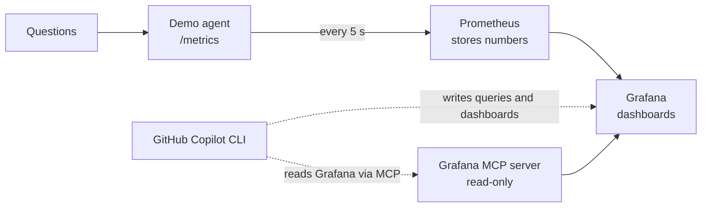

# Who Ate My Tokens?

**Observing LLM agents with Grafana, built with the GitHub Copilot CLI.**

AI agents hide their work. One user question can turn into many calls to an AI model and to tools, and every call costs tokens. Each step re-sends everything before it, so later steps cost more, and a failing tool can make an agent retry until the bill explodes.

This project makes that visible. A small demo agent reports its tokens, cost, speed and tool calls. Prometheus collects the numbers, Grafana shows them, and the GitHub Copilot CLI writes the queries and dashboards from plain English.



## What you will learn

| Lab | Problem it solves | What you build | Result |
|---|---|---|---|
| **Lab 1** · Ask in plain English | Prometheus needs PromQL, which few people know | Copilot writes queries; you check them in Grafana | Tokens per question, cost per hour, p95 time |
| **Lab 2** · Dashboard as code | One-off queries vanish; teams need a page to watch | Copilot writes a Grafana dashboard file | A live "Who Ate My Tokens?" dashboard |
| **Lab 3** · Catch a runaway agent | Retrying agents burn tokens silently | Break a tool on purpose and watch the spike | You find the cause: a failing tool plus retries |

## Why a demo agent instead of a real AI API?

The agent runs in **fake LLM mode** by default: it simulates AI calls with realistic token counts and delays.

- No API keys, sign-ups or costs for anyone
- Works offline and gives the same behaviour on every laptop
- No rate limits, even with a full room running it at once

The token mechanics are the same as with a real model, and the agent can switch to a real model (see [Real model mode](#real-model-mode)). Prices in the lab are illustrative.

## Requirements

- [Docker Desktop](https://www.docker.com/products/docker-desktop/)
- [Node.js 22+](https://nodejs.org) and [Git](https://git-scm.com/downloads)
- A GitHub account with Copilot (the free plan works)
- GitHub Copilot CLI: `npm install -g @github/copilot`, then run `copilot` and type `/login`

No Docker? Open this repo in **GitHub Codespaces** (Code › Codespaces); everything is preinstalled.

## Quick start

```bash
git clone https://github.com/1sheca/who-ate-my-tokens-lab
cd who-ate-my-tokens-lab
docker compose up -d --build
```

| Service | Address | Notes |
|---|---|---|
| Grafana | http://localhost:3000 | login `admin` / `admin`, then Skip |
| Prometheus | http://localhost:9090 | `/targets` should show `token-agent` UP |
| Demo agent | http://localhost:8080 | `/metrics` shows the raw numbers |

Check it works: Grafana › **Explore** › **Prometheus** › Code › `agent_llm_tokens_total` › **Run query**. You should see lines climbing.

---

## Lab 1 · Ask your agent's numbers in plain English

```bash
copilot -sp "Write a PromQL query for tokens per question for my agent"
```

Paste the answer into Grafana Explore. Expect about **4,000 tokens per question**.

Then run `copilot` and ask:

> Write PromQL for: tokens per second by agent step, cost per hour in USD, and p95 time per question. Then run each one against http://localhost:9090/api/v1/query with curl and summarise the results.

Copilot knows the metric names because it reads [`.github/copilot-instructions.md`](.github/copilot-instructions.md) automatically.

## Lab 2 · Dashboard as code

In `copilot`:

> Create grafana/dashboards/tokens.json: a Grafana dashboard titled "Who Ate My Tokens?", uid "tokens", Prometheus datasource uid "prometheus". Panels: stat for tokens per question, stat for cost per hour, time series of tokens per second by step, bar gauge of cost by step over the selected time range, time series of tool calls by tool and status. Refresh 5s, last 15 minutes.

Approve the file. Within about 10 seconds it appears in Grafana › Dashboards › **Workshop**.

A finished version is in `checkpoints/`:

```bash
cp checkpoints/token-dashboard.json grafana/dashboards/      # macOS / Linux
Copy-Item checkpoints\token-dashboard.json grafana\dashboards\  # Windows PowerShell
```

## Lab 3 · Catch a runaway agent

Open the **Agent Overview** dashboard, then break the search tool:

```bash
curl http://localhost:8080/chaos/runaway/on     # Windows: curl.exe
```

Within a minute:

| Signal | Normal | Runaway |
|---|---|---|
| Tokens per question | ~4,200 | ~12,700 |
| Cost per hour (illustrative) | ~$9 | ~$51 |
| Most expensive step | answer | **retry** |
| search_docs errors | ~0 | ~3 per second |

Fix it with `curl http://localhost:8080/chaos/runaway/off`.

**Bonus: let Copilot investigate.** Start the read-only Grafana MCP server with `docker compose --profile mcp up -d`. In `copilot`, run `/mcp add` (name `grafana`, type HTTP, URL `http://localhost:8000/mcp`, tools `*`, Ctrl+S), then ask:

> Using the Grafana tools, look at the token agent's metrics for the last 10 minutes. Why did tokens and cost jump, which step and tool are responsible, and what should I fix?

---

## Metrics

| Metric | Type | Labels |
|---|---|---|
| `agent_llm_tokens_total` | counter | `model`, `token_type`, `step` |
| `agent_llm_cost_usd_total` | counter | `model`, `step` |
| `agent_llm_calls_total` | counter | `model`, `step` |
| `agent_llm_request_duration_seconds` | histogram | `model`, `step` |
| `agent_tool_calls_total` | counter | `tool`, `status` |
| `agent_requests_total` | counter | `status` |
| `agent_request_duration_seconds` | histogram | none |
| `agent_llm_calls_per_request` | histogram | none |
| `agent_runaway_mode` | gauge | none |

## Real model mode

Point the agent at any OpenAI-compatible endpoint. Slow the load generator down for free tiers.

```bash
LLM_MODE=real LLM_BASE_URL=https://models.github.ai/inference LLM_API_KEY=<token> \
LLM_MODEL=openai/gpt-4o-mini INTERVAL_SECONDS=20 docker compose up -d --build agent loadgen
```

For a local model with Ollama: `LLM_BASE_URL=http://host.docker.internal:11434/v1 LLM_API_KEY=ollama LLM_MODEL=llama3.2:1b`.

## Troubleshooting

| Problem | Fix |
|---|---|
| Windows: "port 9090 … forbidden by its access permissions" | In `docker-compose.yml` change `"9090:9090"` to `"19090:9090"`, then `docker compose up -d` |
| Docker: "WSL not installed" | Run `wsl --install --no-distribution` in PowerShell as administrator, then restart |
| PowerShell: "running scripts is disabled" | `Set-ExecutionPolicy -Scope CurrentUser -ExecutionPolicy RemoteSigned` |
| Grafana shows no data | Wait 30 s; set time range to "Last 15 minutes"; check Prometheus `/targets` |

## Clean up

```bash
docker compose --profile mcp down
```

## Project layout

```
agent/                       demo agent (fake or real LLM) and load generator
prometheus/prometheus.yml    collects the agent's metrics every 5 s
grafana/provisioning/        connects Grafana to Prometheus, loads dashboards
grafana/dashboards/          dashboards you create (Lab 2)
checkpoints/                 finished dashboard
.github/copilot-instructions.md   context Copilot reads automatically
.devcontainer/               GitHub Codespaces setup
```
